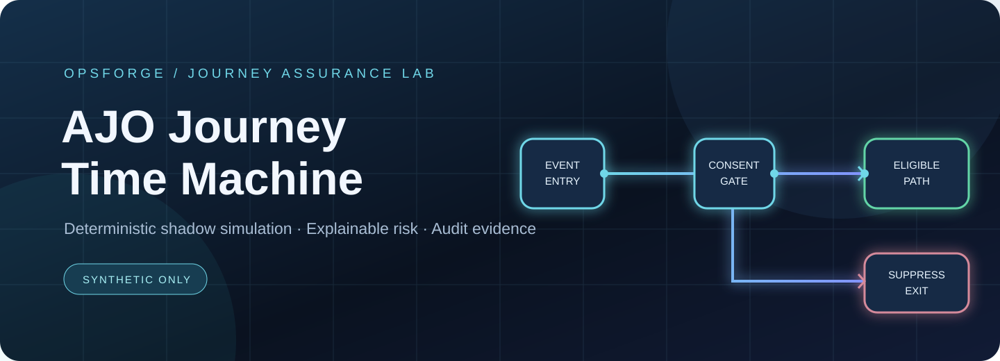

# 🧭 OPSFORGE — AJO Journey Time Machine

[](https://github.com/sghatge/ajo-journey-time-machine/actions/workflows/ci.yml)    [](https://github.com/sghatge/ajo-journey-time-machine/releases/tag/v0.1.0)

🚀 **Live demo:** [ajo-journey-time-machine.streamlit.app](https://ajo-journey-time-machine.streamlit.app/) · **Project site:** [OPSFORGE](https://sghatge.github.io/ajo-journey-time-machine/) · **Release:** [v0.1.0](https://github.com/sghatge/ajo-journey-time-machine/releases/tag/v0.1.0) · **Source:** [GitHub repository](https://github.com/sghatge/ajo-journey-time-machine)

**A deterministic, synthetic-data-first shadow simulator for customer journey orchestration.** Explore consent gates, opt-out handling, duplicate-event signals, projected actions, risk heuristics and hash-chained audit evidence through a polished Streamlit control room and a read-only MCP tool.

> **Safety boundary:** This is an independent assurance prototype. It does not connect to Adobe Experience Platform (AEP) or Adobe Journey Optimizer (AJO), is not Adobe-certified, and cannot publish, pause, send or activate campaigns. Results are advisory and require human review.



## Live product\n\nOpen the hosted [Streamlit application](https://ajo-journey-time-machine.streamlit.app/) to explore the synthetic scenario lab. The public demo uses bundled synthetic events only; do not enter real customer or production data.\n\n## Product experience
- **Control-room UI:** dark Streamlit workspace with scenario selection, run metrics, risk summary and exportable evidence.
- **Scenario lab:** baseline, consent pressure, opt-out pressure and duplicate-event test scenarios.
- **Deterministic engine:** repeatable evaluation of the bundled synthetic event fixture.
- **Fail-closed eligibility:** unknown, pending or denied consent is excluded; opt-outs are excluded.
- **Explainability:** profile paths and findings are visible for review.
- **Audit trail:** append-only JSONL records linked by SHA-256 hashes, with integrity verification.
- **MCP surface:** read-only `run_synthetic_simulation` tool for local agent experimentation.
- **Quality gate:** GitHub Actions runs pytest and Python compilation checks on pushes and pull requests.

## Project documentation
- [Architecture and data flow](docs/architecture.md)
- [Portfolio case study](docs/portfolio-case-study.md)
- [Journey graph validation](docs/journey-graph-validation.md)
- [Changelog](CHANGELOG.md)
- [v0.1.0 release notes](RELEASE_NOTES_v0.1.0.md)

## Quick start — Windows PowerShell
```powershell
py -3.11 -m venv .venv
.\.venv\Scripts\Activate.ps1
python -m pip install --upgrade pip
pip install -r requirements.txt
streamlit run app.py
```

Run tests with `python -m pytest -q`. Run the MCP server with `python time_machine_mcp.py` (stdio), or install the package and run `ajo-time-machine-mcp`.

## MCP server — Claude Desktop, Cursor and Glama

The root-level `time_machine_mcp.py` exposes three local tools over standard input/output:
- `run_synthetic_simulation` — runs the bundled synthetic fixture through the existing deterministic engine and records local demo evidence.
- `validate_journey_definition` — checks YAML journey graph structure; it does not execute branches.
- `verify_demonstration_audit` — verifies the local JSONL SHA-256 hash chain.

Install with `pip install .` or `uv sync`. For a containerized stdio client, build with `docker build -t ajo-journey-time-machine-mcp .` and configure the client to launch `docker run -i --rm ajo-journey-time-machine-mcp`.

Example Claude Desktop MCP configuration (adjust the absolute repository path):

```json
{
  "mcpServers": {
    "ajo-journey-time-machine": {
      "command": "python",
      "args": ["/absolute/path/to/ajo-journey-time-machine/time_machine_mcp.py"]
    }
  }
}
```

This is a local stdio MCP server, not a hosted HTTP endpoint. It uses synthetic fixture data only. It does not parse SQL, connect to AEP/AJO, mint production authorization tokens, revoke agent sessions, pause live journeys, or execute rollback patches. Glama listing and indexing still require a separate submission and review.

## Deploy on Streamlit Community Cloud
1. Push this repository to GitHub.
2. Sign in at [share.streamlit.io](https://share.streamlit.io/) with GitHub.
3. Select **Create app**, repository `sghatge/ajo-journey-time-machine`, branch `main`, main file `app.py`.
4. Deploy. No Adobe credentials or secrets are needed for this synthetic-only MVP.

Platform availability, limits and terms can change; verify current terms before relying on hosted deployment for business-critical use.

## Design principles
1. Synthetic by default — no production customer data or direct identifiers.
2. Fail closed — missing or non-granted consent does not pass eligibility.
3. Explainable — exclusions and findings are surfaced.
4. Deterministic — same fixture and seed produce the same result.
5. Human authority — simulation never grants deployment permission.

## Known MVP limitations
This first release models a deliberately small subset of journey behavior. The YAML journey file is illustrative and is not yet a full executable graph interpreter. The simulator is not a complete AJO emulator, does not reproduce all Adobe runtime semantics, and does not establish production safety. Risk is a transparent heuristic, not a calibrated probability. Audit files on ephemeral hosting are demo evidence only; use a secured append-only store for durable evidence.

## Roadmap

**Current development:** v0.2.0 — structural journey graph validation is now available in the control room; executable branch evaluation remains future work.
- [x] Synthetic fixture and deterministic simulation core
- [x] Consent and opt-out fail-closed checks
- [x] Risk summary and profile trace view
- [x] Hash-chain audit evidence
- [x] Streamlit scenario lab and JSON export
- [x] GitHub Actions quality gate
- [x] Structural journey graph validation (v0.2.0 development)
- [ ] Executable journey graph traversal and branch evaluation
- [ ] Explicit timezone and duplicate-event adversarial test coverage
- [ ] Policy-as-code rules and versioned scenario packs
- [ ] Signed, durable audit evidence and deployment hardening


## Visual identity
- Brand mark and favicon: [OPSFORGE mark](docs/assets/opsforge-mark.svg)
- Journey flow icon: [Flow](docs/assets/icon-flow.svg)
- Governance icon: [Shield](docs/assets/icon-shield.svg)
- Audit evidence icon: [Audit](docs/assets/icon-audit.svg)
- [Branded GitHub Pages site source](docs/index.html)

## License
MIT — see `LICENSE`.
