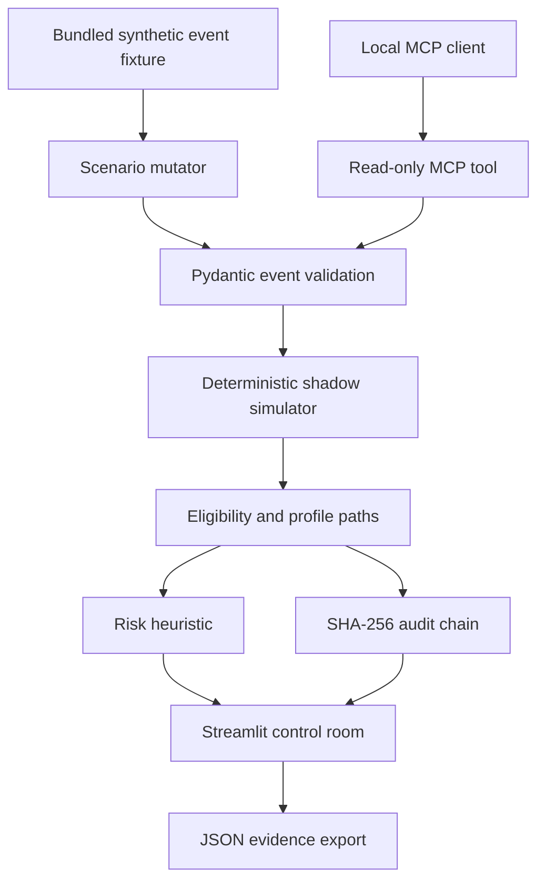

# AJO Journey Time Machine — Architecture

## System context

The application is an independent, synthetic-data-first assurance prototype. It does not connect to Adobe Experience Platform or Adobe Journey Optimizer and does not send, publish, pause, or activate campaigns.

## Components

| Component | Responsibility | Boundary |
|---|---|---|
| `data/sample_events.json` | Bundled sample event stream | Synthetic fixtures only |
| `app.py` | Streamlit UI, scenario selection, visual comparison and evidence export | No campaign activation |
| `src/models.py` | Pydantic event and result schemas | Input validation |
| `src/simulator.py` | Deterministic profile grouping and consent/opt-out eligibility | Simplified model, not an AJO runtime |
| `src/risk.py` | Transparent severity heuristic | Not a calibrated probability |
| `src/audit.py` | JSONL SHA-256 hash-chain append and verification | Local demo evidence; not immutable storage |
| `src/mcp_server.py` | Read-only synthetic simulation tool | Local agent experimentation |

## Data flow

1. A user selects one of four synthetic scenarios.
2. The scenario mutator alters only the bundled fixture in memory.
3. Pydantic validates event structures.
4. The simulator groups events by synthetic profile and applies fail-closed consent/opt-out checks.
5. The risk module classifies the resulting run using documented heuristic thresholds.
6. The audit module appends a hash-linked record.
7. Streamlit presents metrics, flow explanation, baseline comparison, profile traces, findings and downloadable JSON evidence.

## Security and governance principles

- Synthetic data by default; do not upload customer records or production exports.
- Non-granted consent and opt-outs are excluded in this MVP.
- Simulation outputs are advisory and require human review.
- The MCP tool is read-only and uses a bundled fixture.
- No Adobe credentials, production endpoints or campaign write actions are present.

## Known limitations

The diagram's journey flow is explanatory, not a fully executable graph interpreter. The simulator models a deliberately small subset of journey behavior. The audit chain detects edits to recorded entries but does not provide external immutability, signing, access control or durable storage guarantees. Hosted filesystem persistence may be ephemeral.
